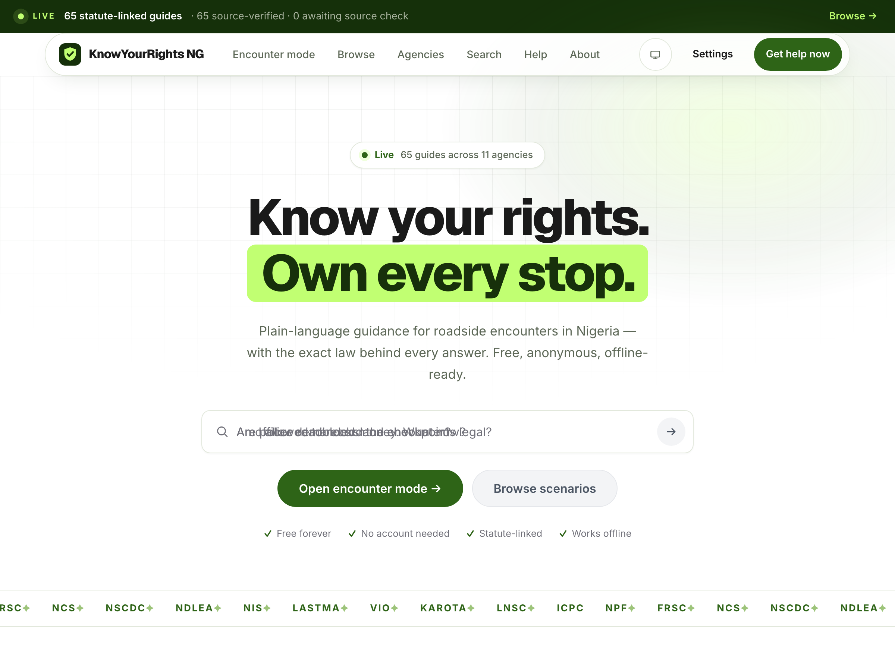
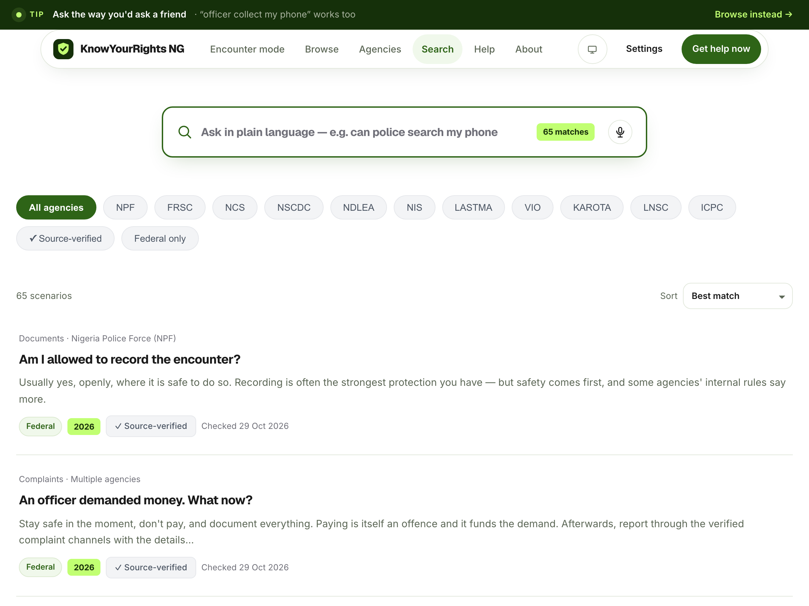
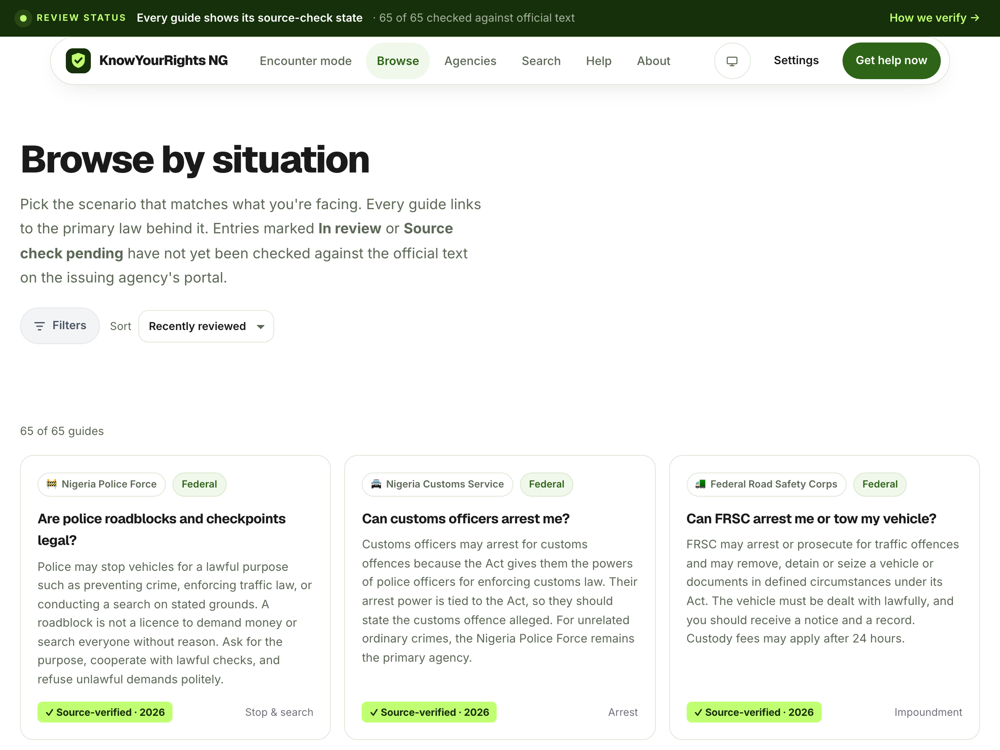

# KnowYourRights NG

> **Free, mobile-first, source-backed guide to Nigerian rights during roadside and related enforcement encounters.**

[](https://know-your-rights-ng.vercel.app)
[](LICENSE)
[](CONTRIBUTING.md)

## 🌐 Live Demo

**https://know-your-rights-ng.vercel.app**

---

## 📱 Screenshots

### Home / Landing Page


### Search with Voice Input


### Browse by Agency & Situation


---

## ✨ Features

### 🎯 Core Functionality
- **65 statute-linked scenarios** across 12 Nigerian statutes
- **12 agencies covered**: NPF, FRSC, NCS, NSCDC, NDLEA, NIS, LASTMA, VIO, KAROTA, LNSC, ICPC, Immigration
- **Source-verified citations** — every guide links to the primary law (Act, Regulation, Constitution section)
- **Honest review status** — badges show *Source-verified*, *In review*, or *Source check pending*

### 🔍 Smart Search
- **Free-text natural language** — ask "officer seized my phone" or "can police search my car"
- **Token-based relevance scoring** with stop-word filtering
- **Live suggestions** as you type
- **Sort by**: Best match · Recently reviewed · Title A–Z · Agency

### 🗣️ Voice Search (Grok-style)
- **Click mic → speak → live transcript appears**
- **Red pulsing animation** while listening
- **Auto-stops on final utterance** → shows confirm/cancel UI
- **Green ✓ to commit**, **✕ to cancel** — transcript stays editable
- **Works offline** (SpeechRecognition is browser-native)

### 📂 Browse & Filter
- **Agency filter chips** (12 agencies + "All agencies")
- **Situation category chips** (Stop & search, Documents, Payments, Arrest, Impoundment, Complaints, Other)
- **Source-verified only** toggle
- **Federal/State jurisdiction** filter
- **URL-synced filters** — shareable deep links
- **Pagination** (12 per page) with skeleton loaders

### 📱 Mobile-First & PWA
- **Responsive down to 320px**
- **Installable PWA** — works offline after first visit
- **Service Worker** caches all content
- **Low-bandwidth mode** in Settings (disables non-critical assets)

### ♿ Accessibility
- Semantic HTML5, ARIA labels, live regions
- Focus-visible outlines, skip links
- Color contrast ≥ 4.5:1
- Reduced-motion support

---

## 🏗️ Tech Stack

| Layer | Technology |
|-------|------------|
| **Framework** | React 19 + Vite 8 |
| **Routing** | React Router 7 |
| **Styling** | Custom CSS (CSS Variables, no framework) |
| **Type Safety** | TypeScript 7 (strict) |
| **Content** | JSON + Zod schemas (validated at build) |
| **PWA** | vite-plugin-pwa (Workbox) |
| **Deploy** | Vercel (SPA rewrite) |
| **CI** | GitHub Actions (typecheck + build + content validation) |

---

## 📁 Project Structure

```
KnowYourRights NG/
├── public/                 # Static assets (icons, manifest)
├── src/
│   ├── components/
│   │   ├── ui/             # Reusable UI primitives
│   │   │   ├── SearchBox.tsx      # 🎤 Voice-enabled search input
│   │   │   ├── Pagination.tsx
│   │   │   ├── Skeleton.tsx
│   │   │   ├── Reveal.tsx         # Scroll-reveal animation
│   │   │   └── ...
│   │   ├── icons.tsx       # Inline SVG icons (mic, check, X, etc.)
│   │   └── Layout.tsx      # App shell + header + mobile menu
│   ├── pages/
│   │   ├── Home.tsx        # Landing page with type-cycling search promo
│   │   ├── Search.tsx      # Full-text search + suggestions + voice
│   │   ├── Browse.tsx      # Filterable, paginated scenario grid
│   │   ├── Scenario.tsx    # Individual guide with statute citations
│   │   ├── Agencies.tsx    # Agency directory + cards
│   │   ├── Encounter.tsx   # Step-by-step roadside mode
│   │   ├── Help.tsx        # Emergency contacts
│   │   ├── About.tsx       # Methodology, review process, corrections
│   │   └── Settings.tsx    # Theme, low-bandwidth, feedback export
│   ├── lib/
│   │   ├── content.ts      # Scenario/agency/source registry (validated)
│   │   ├── search.ts       # Token-based search + tokenizer
│   │   ├── schema.ts       # Zod schemas for all content
│   │   └── scroll.ts       # Smooth scroll utilities
│   ├── hooks/
│   │   └── usePagination.ts
│   ├── styles/
│   │   ├── theme.css       # Design tokens + global components
│   │   ├── home.css
│   │   ├── search.css
│   │   └── browse.css
│   └── main.tsx            # App entry + router + providers
├── legal-sources/          # 📄 Source PDFs (gitignored, local only)
├── scripts/
│   ├── validate-content.cjs  # Build-time content validation
│   └── review-queue.cjs      # Review workflow helpers
├── vercel.json             # SPA rewrite config
└── package.json
```

---

## 🚀 Getting Started

### Prerequisites
- Node.js 20+
- npm 10+

### Install & Dev
```bash
git clone https://github.com/Nierowheezy/KnowYourRights-NG.git
cd KnowYourRights-NG
npm install
npm run dev          # http://localhost:5173
```

### Build & Preview
```bash
npm run build        # Runs content validation + TypeScript + Vite build
npm run preview      # Preview production build locally
```

### Content Validation
```bash
npm run validate:content   # Validates all scenarios against Zod schemas
npm run review:queue       # Shows scenarios needing review
```

---

## 📝 Content Model

Each scenario (`src/lib/schema.ts`) contains:

```typescript
interface Scenario {
  id: string;                    // slug: "police-stop-search-car"
  title: string;                 // "Police stop & search — vehicle"
  shortAnswer: string;           // 1–2 sentence plain-language answer
  legalExplanation: string;      // Detailed explanation with section refs
  exceptions: string;            // When the rule doesn't apply
  practicalOptions: string;      // What you can do in the moment
  whatToAvoid: string;           // Common mistakes
  whatToDocument: string;        // Evidence to collect
  whatToDoAfter: string;         // Follow-up steps
  category: "stop-search" | "payments" | "documents" | "arrest" | "impoundment" | "complaints" | "other";
  jurisdiction: "federal" | "state" | "other";
  agency: string[];              // ["npf", "frsc"]
  sources: SourceRef[];          // [{ sourceId: "constitution-1999", sections: ["s.35", "s.41"] }]
  status: "draft" | "under-review" | "approved" | "needs-revision" | "retired";
  lastReviewed: string;          // ISO date
  reviewer?: string;
  changeHistory: ChangeEntry[];
}
```

**Sources** are separate documents with `currentStatusVerified` boolean — only verified sources produce the ✓ badge.

---

## 🎨 Design System (CSS Variables)

```css
:root {
  /* Colors */
  --forest: #2e6417;        /* Primary brand */
  --forest-hover: #255113;
  --forest-deep: #15300a;
  --lime: #c1ff72;          /* Accent */
  --warning: #ef4444;       /* Recording red */
  --warning-tint: #fef2f2;
  --surface: #ffffff;
  --bg-ground: #f6f8f5;
  --bg-tint: #eef3eb;
  --text: #1a1a1a;
  --text-muted: #6b7280;
  --text-faint: #9ca3af;
  --line: #d1d5db;
  --line-strong: #9ca3af;
  --ring: 0 0 0 3px rgba(46,100,23,0.3);

  /* Typography */
  --font-display: "Geist", system-ui, sans-serif;  /* Headings */
  --font-sans: "Inter", system-ui, sans-serif;     /* Body */

  /* Spacing / Radius */
  --radius: 8px;
  --radius-lg: 12px;
  --radius-pill: 999px;
}
```

Dark mode via `[data-theme="dark"]` overrides in `theme.css`.

---

## 🧪 Testing

```bash
# TypeScript strict check
npx tsc -b

# Content validation (runs in build)
npm run validate:content

# Lint
npm run lint
```

> **Note**: Unit tests not yet configured. Run `/tests` skill to add Vitest + React Testing Library.

---

## 🚢 Deployment

### Vercel (Recommended)
1. Push to GitHub
2. Import in Vercel → **Framework: Vite**
3. **Build Command**: `npm run build`
4. **Output Directory**: `dist`
5. **SPA Rewrite** (auto-detected via `vercel.json`):
   ```json
   { "rewrites": [{ "source": "/((?!assets/).*)", "destination": "/index.html" }] }
   ```

### Manual
```bash
npm run build
# Deploy dist/ to any static host (Netlify, Cloudflare Pages, etc.)
```

---

## 🤝 Contributing

1. Fork → create feature branch
2. Add scenario in `src/content/scenarios/` (JSON + Zod)
3. Run `npm run validate:content`
4. Open PR with source PDF reference

See [CONTRIBUTING.md](CONTRIBUTING.md) for detailed guidelines.

---

## 📄 License

MIT — Free to use, modify, distribute. **Not legal advice.** See [DISCLAIMER](src/pages/About.tsx#L45).

---

## 🙏 Acknowledgments

- Nigerian Constitution (1999, as amended)
- Police Act 2020, FRSC Act 2007, Customs & Excise Management Act, NDLEA Act, NSCDC Act, Immigration Act 2015, ICPC Act 2000
- Lagos State Traffic Law 2018, KAROTA Law, LNSC Law
- Open source icons inspired by Lucide/Feather
- Built with [BuildFlow](https://github.com/buildflow-ai/buildflow) workflow

---

## 📞 Support / Corrections

- **Report an error**: [GitHub Issues](https://github.com/Nierowheezy/KnowYourRights-NG/issues)
- **Request a scenario**: [Discussions](https://github.com/Nierowheezy/KnowYourRights-NG/discussions)
- **Email**: corrections@knowyourrights.ng (coming soon)

---

**Know your rights. Own every stop.** 🛡️